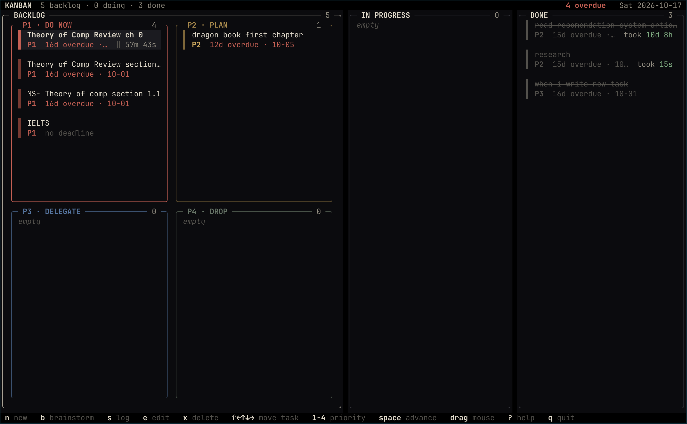

# kanban — a terminal Kanban with a priority matrix

Zig 0.17 + [libvaxis](https://github.com/rockorager/libvaxis). Black canvas, bone-white text,
coloured outlines for the four priority squares.





## Build & run

```sh
zig build run              # needs Zig 0.17.0
zig build -Doptimize=ReleaseSafe && ./zig-out/bin/kanban
zig build test             # model + date parsing tests
```

Data lives in `$KANBAN_FILE`, else `$XDG_DATA_HOME/kanban/board.tsv`,
else `~/.local/share/kanban/board.tsv` — plain tab-separated text, saved after every change.

## Windows
The board saves to `$HOME/.local/share/kanban/board.tsv`, and Windows does not define
`HOME`, so it must be exported from `USERPROFILE`. Open a terminal **inside the repo
folder** first — its name and location don't matter (`git clone` creates `todo-tui`,
GitHub's "Download ZIP" creates `todo-tui-main`, any other name works the same).

Build once:

```powershell
$env:HOME = $env:USERPROFILE      # needed every session — add to your $PROFILE to persist
zig build -Doptimize=ReleaseSafe  # builds zig-out\bin\kanban.exe without launching it
zig build run                     # or just try it out live
```

Install it like a real terminal command (type `kanban` from any folder, just like `cd`
or `ls`): copy the exe out of the repo and drop a launcher into
`%LOCALAPPDATA%\Microsoft\WindowsApps`, which is already on your `PATH`.

```powershell
$dest = "$env:LOCALAPPDATA\Programs\kanban"
New-Item -ItemType Directory -Force $dest | Out-Null
Copy-Item "zig-out\bin\kanban.exe" $dest -Force

@'
@echo off
set "HOME=%USERPROFILE%"
"%LOCALAPPDATA%\Programs\kanban\kanban.exe" %*
'@ | Set-Content -Encoding ASCII "$env:LOCALAPPDATA\Microsoft\WindowsApps\kanban.cmd"
```

Open a new terminal and `kanban` works from anywhere — from `todo-tui`, `todo-tui-main`
or any other folder name, since the launcher points at the installed copy, not the repo.
The wrapper sets `HOME` itself, so it also works when double-clicked from Explorer. To
keep the board somewhere else, add `set "KANBAN_FILE=D:\board.tsv"` to the launcher; to
uninstall, delete `kanban.cmd` and the `%LOCALAPPDATA%\Programs\kanban` folder.

## Keys

| key | action |
| --- | --- |
| `← ↑ ↓ →` / `h j k l` | move the cursor (edges jump to the neighbouring square / column) |
| `⇧+arrows` / `H J K L` | move the selected task to the neighbouring square / column |
| mouse drag | drag a card and drop it on any square or column |
| `n` | new task (lands in the focused square / column) |
| `e`, `Enter`, double-click | edit |
| `1 2 3 4` | set priority (moves it to that square) |
| `space` | advance: backlog → in progress → done |
| `x` | delete (asks first) |
| mouse wheel | scroll a long list |
| `?` | help · `q` / `ctrl+c` quit |

Deadline field accepts `2026-10-05`, `10-05` (next occurrence), `+3` (days), `+2w`,
`today`, `tomorrow`, or empty for none.

## Layout of the code

```
src/main.zig    event loop only
src/state.zig   App state + every operation (select, move, edit, delete, form submit)
src/input.zig   key / mouse events  →  state operations
src/ui.zig      layout, drawing, hit-map for the mouse
src/form.zig    the new/edit modal
src/draw.zig    boxes, clipped text
src/theme.zig   every colour
src/model.zig   Task / Board / Zone  (pure, unit-tested)
src/dates.zig   civil-date maths + deadline parsing (pure, unit-tested)
src/storage.zig load / atomic save
```

### Why I Made a tui Kanban for Zig

I made this Kanban for Zig because I found it to be more efficient compared to Go. Zig's performance and control over memory management made it a better fit for this project. The ability to write low-level code with high-level abstractions was particularly appealing, allowing me to create a tool that is both powerful and easy to use.
